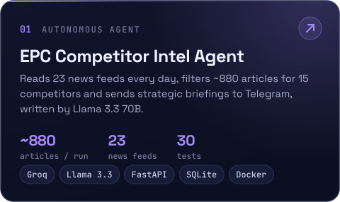
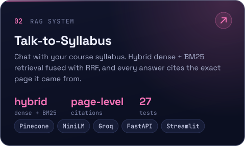
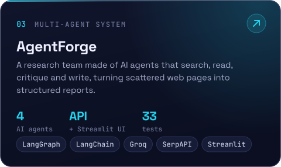
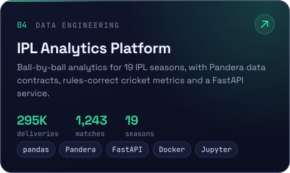
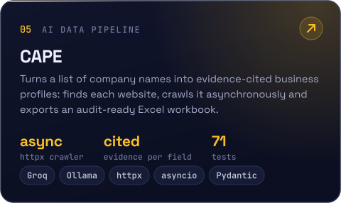
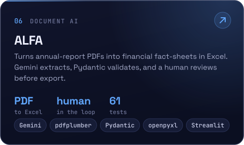
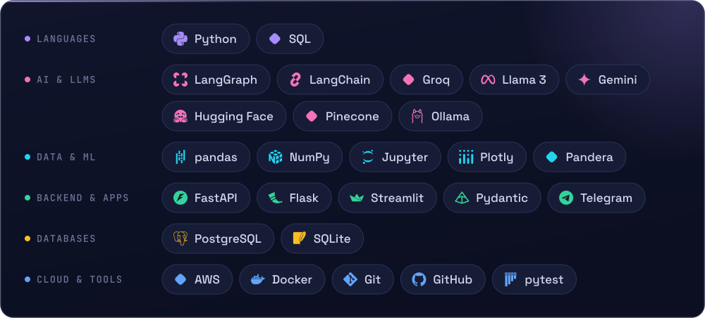
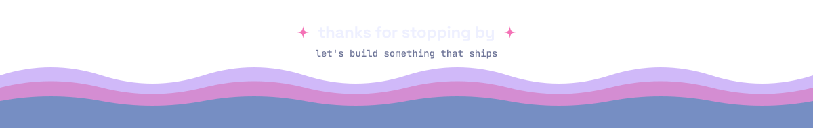

<!-- The artwork in assets/ is generated by scripts/build_assets.py. Edit the text there and re-run it. -->

<picture>
  <source media="(prefers-color-scheme: dark)" srcset="assets/header-dark.svg">
  <source media="(prefers-color-scheme: light)" srcset="assets/header-light.svg">
  
</picture>

<p align="center">
  <a href="https://www.linkedin.com/in/apurv-sharma-ds/"><picture><source media="(prefers-color-scheme: dark)" srcset="assets/btn-linkedin-dark.svg"><source media="(prefers-color-scheme: light)" srcset="assets/btn-linkedin-light.svg"></picture></a>&nbsp;
  <a href="mailto:apurvsharma0514@gmail.com"><picture><source media="(prefers-color-scheme: dark)" srcset="assets/btn-email-dark.svg"><source media="(prefers-color-scheme: light)" srcset="assets/btn-email-light.svg"></picture></a>&nbsp;
  <a href="#-featured-projects"><picture><source media="(prefers-color-scheme: dark)" srcset="assets/btn-projects-dark.svg"><source media="(prefers-color-scheme: light)" srcset="assets/btn-projects-light.svg"></picture></a>
</p>

## ✦ about me

I'm a Data Science undergrad at **ABES Engineering College** (B.Tech CSE, 2023–27) who likes building AI systems that do real work: agents that read hundreds of articles a day, RAG apps that cite their sources, and data pipelines with tests and data contracts. I care about the unglamorous parts too (evals, validation, Docker), so my projects run outside my laptop.

```python
class ApurvSharma:
    role      = "AI & Data Engineer (in the making)"
    education = "B.Tech CSE (Data Science) @ ABES Engineering College, 2023-27"
    location  = "Ghaziabad, India"
    builds    = ["LLM agents", "RAG systems", "ETL pipelines", "analytics APIs"]
    learning  = ["agentic AI systems", "system design for AI apps", "AWS deployment"]
    open_to   = "AI Engineering · Data Engineering · Analytics internships"

    def say_hi(self):
        return "Thanks for stopping by! Let's build something that ships."
```

> [!TIP]
> **Open to internships** in AI Engineering, Data Engineering and Analytics. The quickest way to reach me is [LinkedIn](https://www.linkedin.com/in/apurv-sharma-ds/) or [email](mailto:apurvsharma0514@gmail.com).

## ✦ featured projects

<p align="center">
  <a href="https://github.com/ApurvSharma05/NEWS-AGENT"><picture><source media="(prefers-color-scheme: dark)" srcset="assets/card-news-agent-dark.svg"><source media="(prefers-color-scheme: light)" srcset="assets/card-news-agent-light.svg"></picture></a>
  <a href="https://github.com/ApurvSharma05/TTS-Cloud"><picture><source media="(prefers-color-scheme: dark)" srcset="assets/card-talk-to-syllabus-dark.svg"><source media="(prefers-color-scheme: light)" srcset="assets/card-talk-to-syllabus-light.svg"></picture></a>
  <a href="https://github.com/ApurvSharma05/AgentForge"><picture><source media="(prefers-color-scheme: dark)" srcset="assets/card-agentforge-dark.svg"><source media="(prefers-color-scheme: light)" srcset="assets/card-agentforge-light.svg"></picture></a>
  <a href="https://github.com/ApurvSharma05/IPL-EDA"><picture><source media="(prefers-color-scheme: dark)" srcset="assets/card-ipl-analytics-dark.svg"><source media="(prefers-color-scheme: light)" srcset="assets/card-ipl-analytics-light.svg"></picture></a>
  <a href="https://github.com/ApurvSharma05/CAPE"><picture><source media="(prefers-color-scheme: dark)" srcset="assets/card-cape-dark.svg"><source media="(prefers-color-scheme: light)" srcset="assets/card-cape-light.svg"></picture></a>
  <a href="https://github.com/ApurvSharma05/ALFA"><picture><source media="(prefers-color-scheme: dark)" srcset="assets/card-alfa-dark.svg"><source media="(prefers-color-scheme: light)" srcset="assets/card-alfa-light.svg"></picture></a>
</p>

<details>
<summary><b>more things I've built</b></summary>
<br>

| project | what it does | built with |
| :-- | :-- | :-- |
| [**ReadGood**](https://github.com/ApurvSharma05/ReadGood) | Book discovery and recommendations with shelves, ratings and reading goals · [live demo ↗](https://readgood-etld.onrender.com) | Flask, Bootstrap, NYT & Google Books APIs |
| [**TuneFinder**](https://github.com/ApurvSharma05/TuneFinder) | Mood-based music discovery with in-app 30-second previews | FastAPI, Spotify Web API |
| [**Netflix EDA with SQL**](https://github.com/ApurvSharma05/NETFLIX-EDA-WITH-SQL) | Genre, country and content trends in the Netflix catalogue | SQL (JOINs, CTEs, window functions), Python |

</details>

## ✦ tech stack

<picture>
  <source media="(prefers-color-scheme: dark)" srcset="assets/stack-dark.svg">
  <source media="(prefers-color-scheme: light)" srcset="assets/stack-light.svg">
  
</picture>

<picture>
  <source media="(prefers-color-scheme: dark)" srcset="assets/footer-dark.svg">
  <source media="(prefers-color-scheme: light)" srcset="assets/footer-light.svg">
  
</picture>
